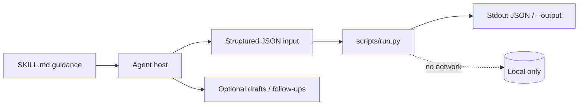
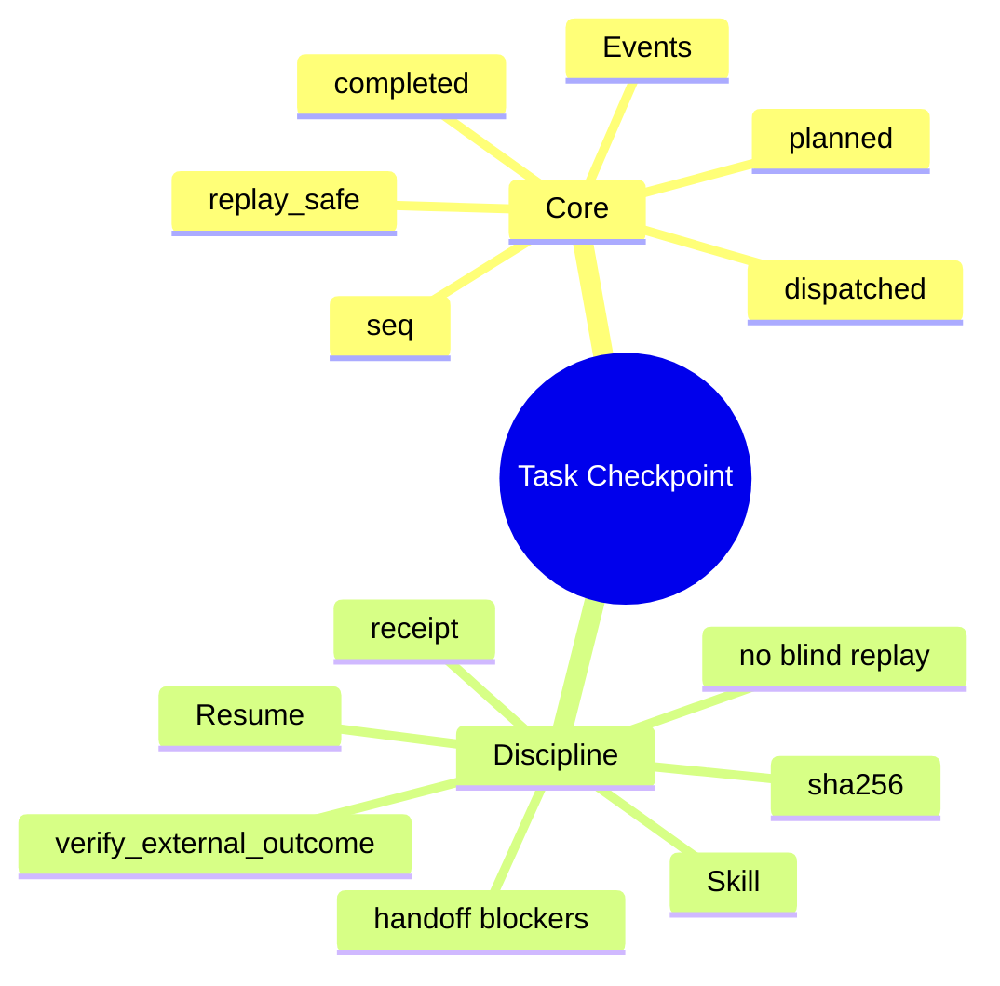

# Task Checkpoint

[English](README.md) · [中文](README.zh-CN.md) · **v0.2.1**

[](https://github.com/KarmenLoop/skill-task-checkpoint/actions/workflows/checks.yml)
[](https://github.com/KarmenLoop/skill-task-checkpoint/releases/latest)
[](https://www.python.org/downloads/)
[](LICENSE)
[](docs/COMPATIBILITY.md)

**Before resuming interrupted work, see what was planned, dispatched, and actually completed—especially uncertain side effects.**

An agent skill plus a local event-log reconstructor: resume queues distinguish replay-safe work from actions that need external verification. You keep the export (or transcript, diff, ledger, event log, or JUnit XML) local; the helper stays on the standard library and never opens a network connection. The skill layer teaches a host *when* to prepare input, *how* to narrate results, and *where* to stop before side effects the user did not authorize.

Built and maintained by [KarmenLoop](https://github.com/KarmenLoop) / [KARMENLOOP](https://karmenloop.com). Current release: **[v0.2.1](https://github.com/KarmenLoop/skill-task-checkpoint/releases/tag/v0.2.1)**. License: **MIT**.


*Actual local output from v0.2.1, rendered as an image. [examples/expected.json](examples/expected.json) · [Image provenance](docs/images/provenance.json).*

[Download v0.2.1](https://github.com/KarmenLoop/skill-task-checkpoint/releases/tag/v0.2.1) · [Tutorial](docs/tutorial.en.md) · [中文教程](docs/tutorial.zh-CN.md) · [Input contract](docs/INPUT.md)

---

## Why this exists

Crashes and host switches invite the worst instinct: repeat the last call. For email, payments, or uploads, that instinct is dangerous.

Task Checkpoint turns an ordered event log into a **resume advisory**. Completed work needs receipts. Dispatched non-replay-safe actions surface as `verify_external_outcome` instead of “just send again.”

A SHA-256 over the normalized checkpoint detects content drift. It does not prove remote completion, restore permissions, or resume a process by itself.

---

## Snapshot

| | |
|---|---|
| **What you install** | Skill tree + `scripts/run.py` checkpoint helper + `install.py` |
| **Runtime** | Python **3.9+**, standard library only |
| **Network** | **None** — does not execute queued work |
| **Input** | UTF-8 JSON: `task_id`, `goal`, `events[]` (`seq`, `action_id`, `state`, `replay_safe` on planned, `receipt` on completed) |
| **Output** | `actions`, `resume_queue`, and `sha256` over normalized content |
| **Install hosts** | `codex` · `deepseek` · `grok` · `agents` |
| **Package id** | `karmen-task-checkpoint` |
| **License** | MIT |

---

## Is / Is not

| Is | Is not |
|---|---|
| Reconstruction of planned/dispatched/completed events | An autonomous daemon or workflow engine |
| Replay-safe vs verify-external guidance | Exactly-once remote execution |
| Checkpoint digest for drift detection | Proof that a provider completed an action |
| Offline stdlib helper | Permission restore or process resume |
| Skill handoff of next safe action + blockers | Authority to resend messages after a crash |

---

## How it works

Two layers stay separate on purpose:

1. **Method layer (`SKILL.md`)** — when to invoke, how to prepare honest input, what to deliver, and which side effects stay forbidden without fresh user authorization.
2. **Deterministic helper (`scripts/run.py`)** — validates a UTF-8 JSON contract (max 10 MiB), computes the result locally, prints JSON to stdout (or a new `--output` file), and exits `2` on invalid input.





### Workflow

1. **Collect** the objective and ordered events, including tool receipts. Intent is not success.
2. **Mark** external mutations as non-replay-safe unless the provider contract establishes idempotency.
3. **Run** the helper. Investigate unknown outcomes at the destination before repeating a send, payment, or upload.
4. **Save** the checkpoint to an explicit new path and hand off next action, blockers, and evidence. The receiving agent rechecks current authorization.

### What the sample proves

The draft has a completion receipt. The dispatched email has none, so the resume queue asks to `verify_external_outcome`.

Exit `0` means processing finished—not that every business finding “passed.”

---

## Quickstart

Download `karmen-task-checkpoint-v0.2.1.zip` and its `.sha256` from the [v0.2.1 release](https://github.com/KarmenLoop/skill-task-checkpoint/releases/tag/v0.2.1), verify the hash, and extract. Requires Python 3.9+.

```sh
python3 scripts/run.py --version
python3 scripts/run.py --input examples/input.json
```

Expected version string: `karmen-task-checkpoint 0.2.1`.

Optional: install into a host that scans a skills directory (installer refuses an existing destination):

```sh
python3 install.py --host agents
# also: --host codex | deepseek | grok
# or:  --destination /exact/new/directory
```

You can run the helper with no AI host at all. Host discovery and invocation still vary—see [docs/tutorial.en.md](docs/tutorial.en.md) and [docs/COMPATIBILITY.md](docs/COMPATIBILITY.md).

Pipe mode and version probe:

```sh
python3 scripts/run.py --input - < examples/input.json
python3 scripts/run.py --version
```

---

## Use it with your own work

Read [docs/INPUT.md](docs/INPUT.md) before shaping a new payload.

- Keep `seq` strictly increasing.
- Compare a replay-safe calculation with a non-replay-safe send.
- Preserve the checkpoint hash across handoffs.
- The queue is advice—never an automatic resend.

The helper needs no model account, API key, or network. An AI host has its own data and permission settings; this skill adds no authority to send, purchase, publish, or change access.

---

## Documentation map

| Doc | Use it when you need… |
|---|---|
| [Tutorial (EN)](docs/tutorial.en.md) · [中文](docs/tutorial.zh-CN.md) | Download, install, practice, upgrade, remove |
| [Input / output contract](docs/INPUT.md) · [中文](docs/input.zh-CN.md) | Field semantics and examples |
| [Compatibility](docs/COMPATIBILITY.md) | Host install paths and unverified boundaries |
| [Validation](docs/VALIDATION.md) | What was actually exercised |
| [Sources](docs/SOURCES.md) | Research notes behind the design |
| [Changelog](CHANGELOG.md) | Release history |
| [Contributing](CONTRIBUTING.md) · [Support](SUPPORT.md) · [Security](SECURITY.md) | Collaboration and reports |

---

## Validation (honest)

Observed baseline (see [docs/VALIDATION.md](docs/VALIDATION.md)): 2026-10-18 (UTC) · Python 3.9.6 · macOS arm64 (see docs/VALIDATION.md).

| Check | Result |
|---|---|
| `python3 scripts/run.py --input examples/input.json` | Exit 0; fixture aligned with live output |
| `python3 -m unittest discover -s tests -v` | Exit 0 on maintainer run |
| `skill-creator` quick validate | Metadata accepted |

**Not claimed:** authenticated conversations inside every supported host, live account connectors, or native Windows/Linux host UI coverage. Installation is tested in temporary directories; model interpretation remains a host responsibility. Confirm the exact `SKILL.md` is discovered before relying on invocation.

CI: [`.github/workflows/checks.yml`](https://github.com/KarmenLoop/skill-task-checkpoint/actions/workflows/checks.yml).

---

## FAQ

### What is Task Checkpoint, in one sentence?

An MIT skill and offline helper that reconstructs interrupted work from an event log and advises what is safe to resume versus what needs external verification.

### Will it resend a message after a crash?

No. Dispatched non-replay-safe actions require outcome verification before any new authorized execution.

### Does the digest prove the email arrived?

No. SHA-256 detects checkpoint content changes only.

### Where does output go?

Stdout or new `--output`; existing files preserved.

### Install?

`python3 install.py --host agents` (also `codex` / `deepseek` / `grok`).

### Is this a transactional engine?

No. Writing JSON does not make remote effects exactly-once.

---

## License and contact

[MIT](LICENSE) · Keep the license and [notice](NOTICE.md) with redistributed copies.

[karmenloop.com](https://karmenloop.com) · [GitHub @KarmenLoop](https://github.com/KarmenLoop) · [info@karmenloop.com](mailto:info@karmenloop.com)

KARMENLOOP Official Team · Shanghai

<!-- Copyright (C) 2026 KARMENLOOP Official Team
SPDX-License-Identifier: MIT -->
