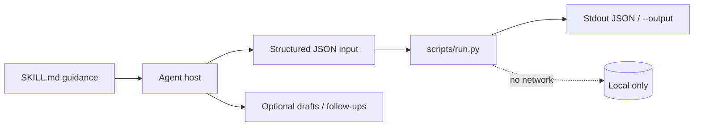
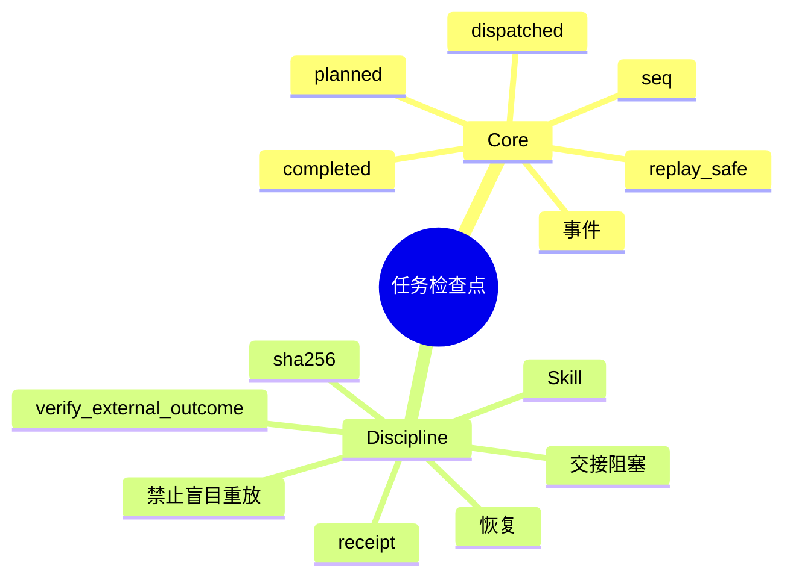

# 任务检查点

[English](README.md) · [中文](README.zh-CN.md) · **v0.2.1**

[](https://github.com/KarmenLoop/skill-task-checkpoint/actions/workflows/checks.yml)
[](https://github.com/KarmenLoop/skill-task-checkpoint/releases/latest)
[](https://www.python.org/downloads/)
[](LICENSE)
[](docs/COMPATIBILITY.md)

**恢复中断工作前，先看清计划过、已派出、真正完成的是什么——尤其是不确定的副作用。**

一套 Agent Skill，外加本地事件日志重建器：恢复队列区分可重放工作与需外部核验的动作。 导出（或会议文本、diff、账本、事件日志、JUnit XML）留在本地；辅助程序只用标准库，从不发起网络连接。Skill 层教宿主*何时*准备输入、*如何*陈述结果，以及在用户未授权的副作用前*停在哪里*。

由 [KarmenLoop](https://github.com/KarmenLoop) / [KARMENLOOP](https://karmenloop.com) 维护。当前发布：**[v0.2.1](https://github.com/KarmenLoop/skill-task-checkpoint/releases/tag/v0.2.1)**。许可证：**MIT**。


*v0.2.1 真实本地输出渲染图。[examples/expected.json](examples/expected.json) · [图像出处](docs/images/provenance.json)。*

[下载 v0.2.1](https://github.com/KarmenLoop/skill-task-checkpoint/releases/tag/v0.2.1) · [英文教程](docs/tutorial.en.md) · [中文教程](docs/tutorial.zh-CN.md) · [输入契约](docs/input.zh-CN.md)

---

## 为什么做这个

崩溃与宿主切换会诱发最糟直觉：把上次调用再跑一遍。对邮件、支付或上传来说，这很危险。

任务检查点把有序事件日志变成**恢复建议**。已完成工作需要回执。已派出且不可重放的动作会以 `verify_external_outcome` 出现，而不是「再发一次」。

对规范化检查点的 SHA-256 可检测内容漂移。它不证明远端完成，不恢复权限，也不自行拉起进程。

---

## 快照

| | |
|---|---|
| **安装内容** | Skill 树 + `scripts/run.py` 检查点辅助程序 + `install.py` |
| **运行时** | Python **3.9+**，仅标准库 |
| **网络** | **无** — 不执行队列中的工作 |
| **输入** | UTF-8 JSON：`task_id`、`goal`、`events[]`（`seq`、`action_id`、`state`，planned 上的 `replay_safe`，completed 上的 `receipt`） |
| **输出** | `actions`、`resume_queue`，以及对规范化内容的 `sha256` |
| **安装宿主** | `codex` · `deepseek` · `grok` · `agents` |
| **包标识** | `karmen-task-checkpoint` |
| **许可证** | MIT |

---

## 是 / 不是

| 是 | 不是 |
|---|---|
| 重建 planned/dispatched/completed 事件 | 自治守护进程或工作流引擎 |
| 可重放 vs 外部核验建议 | 远端 precisely-once 执行 |
| 用于漂移检测的检查点摘要 | 提供商已完成动作的证明 |
| 离线标准库辅助程序 | 权限恢复或进程续跑 |
| Skill 交接下一步安全动作与阻塞项 | 崩溃后重发消息的权限 |

---

## 工作方式

两层有意分开：

1. **方法层（`SKILL.md`）** — 何时调用、如何准备诚实输入、交付什么，以及哪些副作用在没有新的用户授权时仍禁止。
2. **确定性辅助程序（`scripts/run.py`）** — 校验 UTF-8 JSON 契约（最大 10 MiB），本地计算，打印到 stdout（或新的 `--output`），非法输入以 `2` 退出。





### 流程

1. **收集**目标与有序事件，含工具回执。意图不等于成功。
2. **标记**外部变更默认可不重放，除非提供商契约确立幂等。
3. **运行**辅助程序。在重复发送、支付或上传前，先到目的地核验未知结果。
4. **把检查点存到明确的新路径**，并交接下一步、阻塞与证据。接收方重新核对当前授权。

### 示例证明什么

草稿已有完成回执。已派出的邮件没有，因此恢复队列要求 `verify_external_outcome`。

退出码 `0` 表示处理完成——不表示业务上「全部通过」。

---

## 快速开始

从 [v0.2.1 发布页](https://github.com/KarmenLoop/skill-task-checkpoint/releases/tag/v0.2.1) 下载 `karmen-task-checkpoint-v0.2.1.zip` 与对应 `.sha256`，校验哈希后解压。需要 Python 3.9+。

```sh
python3 scripts/run.py --version
python3 scripts/run.py --input examples/input.json
```

期望版本串：`karmen-task-checkpoint 0.2.1`。

可选：安装到会扫描 skills 目录的宿主（目标已存在则拒绝）：

```sh
python3 install.py --host agents
# 亦可：--host codex | deepseek | grok
# 或：  --destination /精确/新目录
```

完全可以不借助 AI 宿主直接跑辅助程序。宿主发现与调用方式仍因产品而异——见 [docs/tutorial.zh-CN.md](docs/tutorial.zh-CN.md) 与 [docs/COMPATIBILITY.md](docs/COMPATIBILITY.md)。

管道与版本探测：

```sh
python3 scripts/run.py --input - < examples/input.json
python3 scripts/run.py --version
```

---

## 用在你自己的工作上

准备新载荷前先读 [docs/input.zh-CN.md](docs/input.zh-CN.md)（或 [docs/INPUT.md](docs/INPUT.md)）。

- 保持 `seq` 严格递增。
- 对照可重放计算与不可重放发送。
- 交接时保留检查点哈希。
- 队列是建议——从不是自动重发。

辅助程序不需要模型账号、API 密钥或网络。AI 宿主有自己的数据与权限设置；本 skill 不授予发送、购买、发布或改权限的权力。

---

## 文档地图

| 文档 | 何时使用 |
|---|---|
| [教程（中文）](docs/tutorial.zh-CN.md) · [English](docs/tutorial.en.md) | 下载、安装、练习、升级、卸载 |
| [输入/输出契约（中文）](docs/input.zh-CN.md) · [EN](docs/INPUT.md) | 字段语义与示例 |
| [兼容性](docs/COMPATIBILITY.md) | 宿主安装路径与未验证边界 |
| [验证](docs/VALIDATION.md) | 实际跑过什么 |
| [来源](docs/SOURCES.md) | 设计背后的研究笔记 |
| [变更日志](CHANGELOG.md) | 发布历史 |
| [贡献](CONTRIBUTING.md) · [支持](SUPPORT.md) · [安全](SECURITY.md) | 协作与报告 |

---

## 验证（如实）

基线见 [docs/VALIDATION.md](docs/VALIDATION.md)：2026-10-18 (UTC) · Python 3.9.6 · macOS arm64 (see docs/VALIDATION.md)。

| 检查 | 结果 |
|---|---|
| `python3 scripts/run.py --input examples/input.json` | 退出 0；夹具与实跑输出对齐 |
| `python3 -m unittest discover -s tests -v` | 维护者环境退出 0 |
| `skill-creator` 快速校验 | 元数据通过 |

**未声称：** 每个支持宿主内的已登录对话、在线账号连接器，或 Windows/Linux 宿主 UI 全覆盖。安装在临时目录测过；模型如何解释仍是宿主责任。依赖调用前请确认精确的 `SKILL.md` 已被发现。

CI：[`.github/workflows/checks.yml`](https://github.com/KarmenLoop/skill-task-checkpoint/actions/workflows/checks.yml)。

---

## 常见问题

### 一句话：任务检查点是什么？

MIT Skill + 离线辅助程序：从事件日志重建中断工作，并建议何可安全恢复、何需外部核验。

### 崩溃后会重发消息吗？

不会。已派出且不可重放的动作须先核验结果，才能再次授权执行。

### 摘要能证明邮件已送达吗？

不能。SHA-256 只检测检查点内容是否变化。

### 输出到哪？

stdout 或新的 `--output`；保留已有文件。

### 如何安装？

`python3 install.py --host agents`（也支持 `codex` / `deepseek` / `grok`）。

### 这是事务引擎吗？

不是。写入 JSON 不会让远端效果变成 exactly-once。

---

## 许可与联系

[MIT](LICENSE)。再分发时请保留许可证与 [声明](NOTICE.md)。

[karmenloop.com](https://karmenloop.com) · [GitHub @KarmenLoop](https://github.com/KarmenLoop) · [info@karmenloop.com](mailto:info@karmenloop.com)

KARMENLOOP Official Team · 上海

<!-- Copyright (C) 2026 KARMENLOOP Official Team
SPDX-License-Identifier: MIT -->
