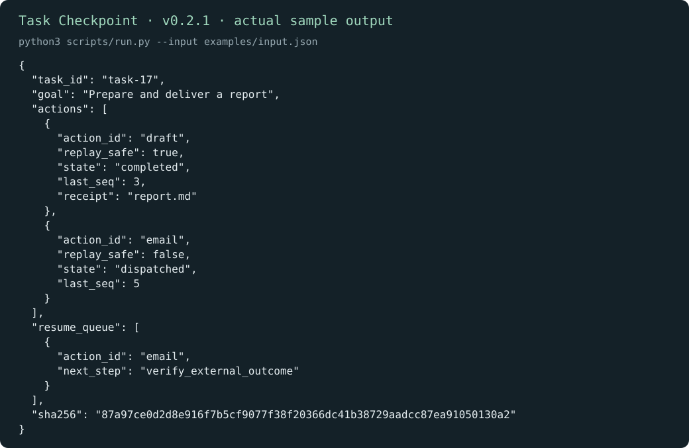

# Task Checkpoint · 任务恢复检查点

[English](README.md) | 简体中文

继续一项中断任务前，先弄清哪些只是计划、哪些已经发出、哪些确实完成。检查点会保留结果不明的操作，避免直接重做可能产生副作用的动作。

[下载 v0.2.1](https://github.com/KarmenLoop/skill-task-checkpoint/releases/tag/v0.2.1) · [完整教程](docs/tutorial.zh-CN.md) · [输入参考](docs/input.zh-CN.md) · [反馈问题](https://github.com/KarmenLoop/skill-task-checkpoint/issues)

## 能做什么

草稿已有完成回执；邮件已发出调用但没有确认结果，因此恢复队列要求 verify_external_outcome。

工具汇总事件日志，不会执行队列、核验外部回执、恢复权限或自行重启进程。



*图片来自 v0.2.1 的真实本地输出，采用英文键名；[完整结果](examples/expected.json) · [图片来源记录](docs/images/provenance.json)。*

## 开始使用

在发行页下载 `karmen-task-checkpoint-v0.2.1.zip` 与对应 `.sha256` 文件，核对哈希后解压。在解压目录中使用 Python 3.9 或更新版本：

```sh
python3 scripts/run.py --version
python3 scripts/run.py --input examples/input.json
```

预期版本：`karmen-task-checkpoint 0.2.1`。草稿已有完成回执；邮件已发出调用但没有确认结果，因此恢复队列要求 verify_external_outcome。

如果宿主读取 `~/.agents/skills`，可安装完整技能：

```sh
python3 install.py --host agents
```

目标目录已存在时安装器会拒绝覆盖。宿主发现和调用方式可能不同，见[安装与实践教程](docs/tutorial.zh-CN.md)。不使用 AI 宿主也能直接运行本地工具。

## 用于自己的任务

seq 必须严格递增。每个动作从 planned 开始并明确 replay_safe；completed 事件必须带 receipt。

比较可重放的计算与不可随意重放的发送动作。保留检查点哈希，先检查外部实际结果，再决定是否重复结果不明的操作。

准备新输入前可查看[字段约定](docs/input.zh-CN.md)。工具只依赖 Python 标准库，本身不需要模型账号、API 密钥或网络。使用 AI 宿主时，宿主有自己的数据与权限设置。

## 常见问题

**崩溃后会自动重发消息吗？** 不会。队列只是建议；已发出、不可随意重放的动作应先核对结果，再考虑新的授权执行。

**结果保存在哪里？** 默认向终端输出 JSON；使用 `--output` 时只创建新文件，已有输出文件会保留。工具只读取提交的记录和输入约定中明确列出的本地路径。

## 文档与支持

- [下载、安装、配置、练习、升级与卸载](docs/tutorial.zh-CN.md)
- [输入输出约定](docs/input.zh-CN.md)与[兼容性说明](docs/COMPATIBILITY.md)（英文参考）
- [更新记录](CHANGELOG.md)、[参与贡献](CONTRIBUTING.md)、[支持](SUPPORT.md)和[安全反馈](SECURITY.md)

## 许可证

[MIT](LICENSE)。再分发时保留许可证和[声明](NOTICE.md)。由 [KarmenLoop](https://karmenloop.com) 维护。
